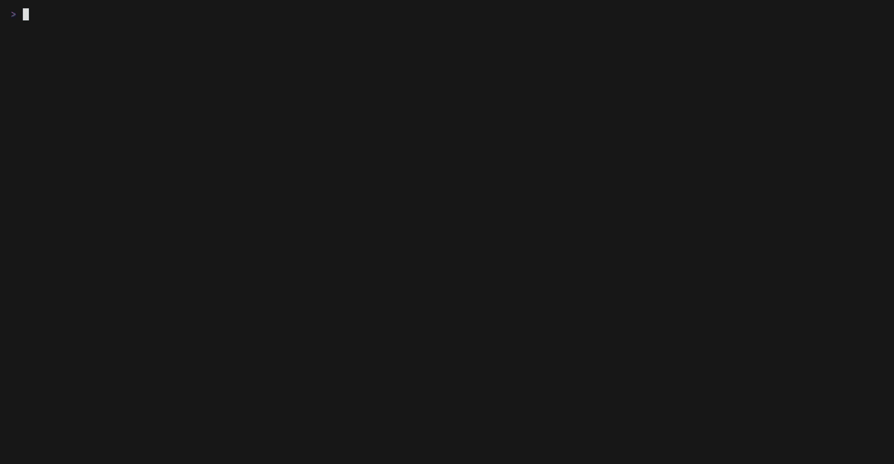

# tracespace



your code already has a shape. you just can't see it from inside the file.

tracespace draws it. c and c++. every function is a box. loops go around. calls hang underneath. it sits next to neovim and changes while you type. it doesn't wait for you to save. it doesn't mind if the code is broken.

## install

you need a c++20 compiler, cmake, make, git, and neovim 0.10 or newer.

```sh
git clone https://github.com/vmfunc/tracespace
cd tracespace
make install-nvim
```

that's all of it. it builds, puts the binary under `~/.local` (`%LOCALAPPDATA%\tracespace` on windows), and adds one file to your lazy.nvim config. if you don't use lazy.nvim it tells you the two lines to add yourself.

restart neovim. open a c or c++ file.

```
:Tracespace
```

run it again and it goes away.

## inside

move into the diagram window.

| key | |
| --- | --- |
| arrows | walk between boxes |
| `enter` | go to that code |
| `space` | fold a box |
| `tab` | execution order, or the order it was written |
| `T` | change how the arcs look |
| `L` | show the calls that live outside the file |
| `?` | if you forget |
| `q` | leave |

`:help tracespace` knows the rest.

## without neovim

the binary is in `bin` under the install folder. it watches the file and redraws when you save.

```sh
tracespace file.cpp
tracespace --print file.cpp
```

## leaving

```sh
make uninstall
```

everything in the file is connected. now you can look at it.
